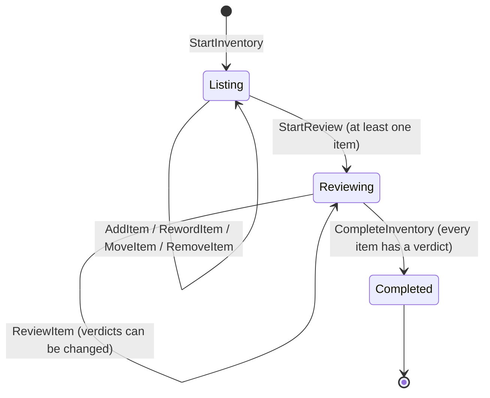

# Domain model

The mental inventory step from the Bullet Journal method, as code in
`src/MentalInventory.Domain`. Why it is event sourced:
[ADR-0004](adr/0004-event-sourced-domain-with-the-decider-pattern.md).

## Language

| Term | Meaning |
|------|---------|
| **Inventory** | One sitting: write everything down, then review it. The aggregate, and one event stream. |
| **Column** | *Working on*, *Should be working on* or *Want to be working on*. |
| **Item** | One thing written in a column. Plain text, at most 280 characters. |
| **Review** | Asking of each item: is it **vital**? Does it **matter**? |
| **Verdict** | `Vital`, `Matters` or `Struck` (neither). |
| **Kept items** | Items with verdict `Vital` or `Matters`. What goes into the journal. |
| **Remove** | Deleting an item added by mistake while listing. Not the same as striking it. |

## Lifecycle

A completed inventory is read-only.

## Commands and events

| Command | Event | Allowed in |
|---------|-------|------------|
| `StartInventory` | `InventoryStarted` | not started |
| `AddItem` | `ItemAdded` | Listing |
| `RewordItem` | `ItemReworded` (none if unchanged) | Listing |
| `MoveItem` | `ItemMoved` (none if same column) | Listing |
| `RemoveItem` | `ItemRemoved` | Listing |
| `StartReview` | `ReviewStarted` | Listing, with items |
| `ReviewItem` | `ItemReviewed` (none if same verdict) | Reviewing |
| `CompleteInventory` | `InventoryCompleted` | Reviewing, all reviewed |

A rejected command throws `InventoryRuleViolation`. Ids are client-generated
(GUID v7), and time is passed in on the commands that need it, so the decider stays pure.

## Open questions

- **Back to listing:** should it be possible to add an item during review (you often think
  of something new), or to go back from review to listing?
- **Carrying items over:** when starting a new inventory, offer the previous one's kept
  items? That would be a new item that references its origin, not a shared entity.
- **Afterwards:** kept items become tasks, events or goals in the journal. Whether the app
  follows them further, or stops at the inventory, is a product decision.
